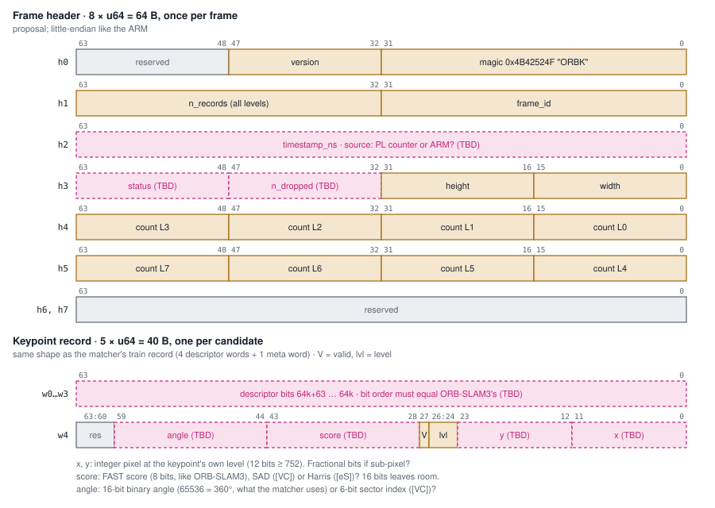

# Integration contract

The extractor-output record and frame header are what every stage hands to the next and what
the matcher and ARM side consume. Proposed layout:

**Status: draft. These fields are still team decisions:**

- [ ] Keypoint coordinate format (integer / fixed-point, which level's frame)
- [ ] Score: kept or dropped, width
- [ ] Angle format (degrees float in ORB-SLAM3 → fixed-point or bin index?)
- [ ] Descriptor bit order (which of the 256 pattern pairs is bit 0)
- [ ] Candidate cap per frame / per level
- [ ] Frame bookkeeping (frame ID, level counts, end-of-frame marker)

When a field is settled, record it here and in `common/rtl/`, and update every stage's model.
